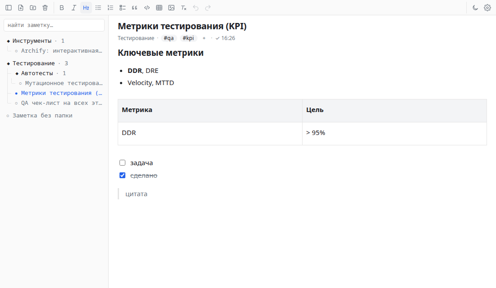

# Помощник

Расширение для браузера: ИИ-помощник в боковой панели на локальных моделях Ollama и личные Markdown-заметки рядом с ним. Вверху переключатель «Чат» / «Заметки».

**Чат и страница.** В режиме «Чат» помощник видит открытую вкладку: на вопрос «что на этой странице?», «какие тут кнопки?» или «перескажи статью» модель сама читает страницу и отвечает. Ещё она умеет искать и читать ваши заметки.

**Агент.** В режиме «Агент» помощник сам выполняет задачу на страницах: кликает, вводит текст, выбирает в списках, переходит по ссылкам, открывает вкладки, выделяет найденное цветом, создаёт заметки и дописывает в них. Например: «найди на сайте, как настраивается X, и выдели этот текст», «нажми кнопку и скажи, что изменилось», «перейди на страницу Y и прочитай заголовок». Шаги видны свёрнутой строкой над ответом, вкладки задачи собираются в одну группу, а страница, с которой работает агент, обведена рамкой (её можно выключить в настройках).

**Опасные действия.** Отправка форм, удаление, выход из аккаунта в режиме «Спрашивать» ждут вашего решения: в ленте появляется карточка «Разрешить / Разрешать на этом сайте / Отклонить». В режиме «Сам» агент делает это без вопроса. Оплату, выдачу доступа, ввод паролей и кодов агент никогда не делает сам: он просит вас сделать этот шаг и нажать «Готово». В настройках можно задать правила для сайтов: «разрешать», «спрашивать» или «блокировать».

**Поиск багов.** Профиль «QA-тестировщик» ищет баги на сайте: собирает ошибки консоли и упавшие запросы, проверяет страницу (битые картинки, ссылки этого сайта с ошибкой, элементы без подписей, картинки без `alt`, вылезание за край окна, наложенные друг на друга элементы), обходит разделы сайта и описывает каждый баг: страница, шаги, ожидаемо, фактически, доказательство. Консоль и сеть видны с момента подключения к вкладке; чтобы собрать с начала загрузки, агент перезагружает страницу. Если модель видит изображения (как `qwen3.5:35b-a3b`), помощник ещё делает скриншот и проверяет вёрстку глазами. В режиме «Чат» проверки тоже доступны, но без перезагрузки страницы.

**Длинные задачи.** Длинная задача агента и длинный чат не переполняют окно контекста модели: старые описания страниц и старые ответы помощника сокращаются, а ваши сообщения остаются дословно. Если задачу прервали (кнопка «Стоп», перезапуск браузера), под ответом появляется «↻ Продолжить»: агент продолжит с того места, где остановился, с учётом уже сделанных шагов; если браузер не перезапускали — в тех же вкладках задачи.

На время работы со страницей Chrome показывает над ней полосу «… запустил отладку этого браузера»: так расширение читает страницу и действует на ней. После ответа полоса исчезает.

**Чат.** Ответ модели приходит по частям и отрисовывается как Markdown, рассуждения модели показываются свёрнутыми. Ответ можно остановить. Чаты сохраняются, в списке «Недавние» их можно найти, переименовать или удалить. Если закрыть панель посреди ответа, он всё равно допишется и сохранится. Профили помощника (роль и набор инструментов) переключаются прямо в чате и редактируются в настройках. Для примера есть два профиля: «Помощник» и «QA-тестировщик».

**Заметки.** Слева дерево папок с поиском, справа заметка. Визуальный редактор: заголовки, списки, задачи, цитаты, код, таблицы, картинки. У заметок есть теги, в настройках есть резервная копия на диск.

Данные хранятся только в браузере (IndexedDB). Аккаунта, сервера и аналитики нет. Запросы уходят только к Ollama по адресу из настроек; текст страницы, которую читает помощник, тоже отправляется только туда. Пароли, номера карт и одноразовые коды со страниц модели не передаются.

> Устройство и решения описаны в [дизайне](docs/superpowers/specs/2026-11-04-ai-assistant-design.md) и планах этапов в `docs/superpowers/plans/`.



## Совместимость

| Браузер | Поддержка |
| --- | --- |
| Google Chrome | ✅ Работает, протестировано |
| Microsoft Edge, Brave, Opera и другие Chromium-браузеры | ⚠️ Не тестировалось (должно работать, так как использует стандартный Manifest V3 и Chrome API) |
| Firefox, Safari | ❌ Не поддерживается |

## Установка

Расширение не публикуется в Chrome Web Store, оно устанавливается вручную как распакованное. Всё нужное уже собрано и лежит в репозитории (`app/dist/`, `app/vendor/`), поэтому Node.js и сборка не нужны, понадобится только Git (или можно скачать ZIP без него, см. шаг 1).

1. Склонируйте репозиторий:

   ```
   git clone https://github.com/Pauelbel/my-browser-notes-ext.git
   ```

   Вместо этого можно скачать код без Git: на странице репозитория на GitHub нажать «Code» → «Download ZIP» и распаковать архив.
2. Откройте в Chrome страницу `chrome://extensions`.
3. Включите переключатель «Режим разработчика» (в правом верхнем углу страницы).
4. Нажмите «Загрузить распакованное расширение».
5. В открывшемся диалоге выберите папку `app` внутри склонированного/распакованного репозитория (например, `my-browser-notes-ext/app`) и подтвердите выбор.
6. Расширение появится в списке и в панели расширений Chrome (значок пазла в тулбаре). Закрепите его, если нужен быстрый доступ.
7. Откройте боковую панель значком в тулбаре, затем в ⚙ Настройки → «Модель» проверьте подключение к Ollama и выберите модель.

## Ollama

Помощник работает с [Ollama](https://ollama.com), запущенной на этом же компьютере (по умолчанию `http://localhost:11434`). Нужны две переменные окружения:

- `OLLAMA_ORIGINS=chrome-extension://*`: без неё Ollama отклоняет запросы расширения (ошибка 403, в настройках будет подсказка).
- `OLLAMA_CONTEXT_LENGTH=16384` или больше: контекст по умолчанию слишком мал для будущего агентного режима. Размер контекста нельзя передать в запросе через OpenAI-совместимый адрес Ollama, поэтому он задаётся здесь.

Linux с systemd:

```
sudo systemctl edit ollama
# в открывшемся файле:
[Service]
Environment="OLLAMA_ORIGINS=chrome-extension://*"
Environment="OLLAMA_CONTEXT_LENGTH=32768"
# затем:
sudo systemctl restart ollama
```

Запуск вручную: `OLLAMA_ORIGINS='chrome-extension://*' OLLAMA_CONTEXT_LENGTH=32768 ollama serve`.

Проверено с моделью `qwen3.5:35b-a3b`.

## Обновление

Чтобы обновить расширение после изменений в папке `app/`, откройте `chrome://extensions` и нажмите «Обновить» на карточке расширения, затем заново откройте панель. Не удаляйте расширение из Chrome: вместе с ним удалятся все заметки и чаты, они хранятся только в браузере. Перед любыми рискованными действиями сохраните резервную копию заметок.

> **Переход с «Заметок» 1.0.** Заметки сохраняются как есть. Чаты и профили хранятся в отдельной базе.

## Резервная копия

⚙ Настройки → «Резервная копия»: выберите папку на диске и нажмите «Сохранить копию». При каждом сохранении внутри выбранной папки создаётся новая подпапка `Заметки-ГГГГ-ММ-ДД_чч-мм-сс`. В ней те же папки, что в расширении, и по `.md`-файлу на каждую заметку (название, теги и даты лежат во фронтматтере). Существующие файлы не перезаписываются. Загрузить копию обратно в расширение нельзя, копирование работает только в одну сторону. Чаты в резервную копию не входят.

## Разработка

Всё, включая инструменты разработки, лежит в [app/](app/). Это же и есть папка, которую загружают в Chrome. Новый код написан на TypeScript в `app/src/` и собирается esbuild в `app/dist/`. Код заметок (`app.js`, `db.js`, `tree.js`, `backup.js`) остаётся на JavaScript. Собранные файлы коммитятся, чтобы установка не требовала Node.js. Команды ниже выполняются из папки `app/` (если `pnpm` не установлен, подойдёт `npx -y pnpm@10 …`):

- `pnpm install --frozen-lockfile`: установить зависимости.
- `pnpm build`: собрать `dist/` (помощник) и `vendor/editor.js` (редактор Tiptap).
- `pnpm test`: тесты (`node --test`, TypeScript запускается напрямую средствами Node 22).
- `pnpm typecheck`: проверка типов.
- `pnpm e2e`: автоматические проверки слоя работы со страницей в настоящем Google Chrome (без окна, во временном профиле) на тестовых страницах из `tests/fixtures/pages`. Нужен установленный Google Chrome (или путь в `CHROME_PATH`); без него проверки пропускаются.
  - `pnpm e2e record`: заново записать снимки тестовых страниц в `tests/fixtures/cdp` для юнит-тестов описания (после изменений в `src/page/capture.ts` или в тестовых страницах).
  - `pnpm e2e realsites`: выборочная проверка на пяти настоящих сайтах (нужна сеть).
  - `pnpm e2e chat-tools`: чтение страницы моделью в чате (нужна Ollama с `qwen3.5:35b-a3b`).
  - `pnpm e2e agent`: задачи агента на тестовых страницах с настоящей моделью: подсветка, клик, удаление с подтверждением, переход, поиск багов (у каждого сценария одна повторная попытка: модель отвечает по-разному).
  - `pnpm e2e resume`: остановка фонового скрипта посреди задачи агента и «Продолжить».

Лицензии зависимостей перечислены в `app/vendor/THIRD_PARTY_NOTICES.txt`.
